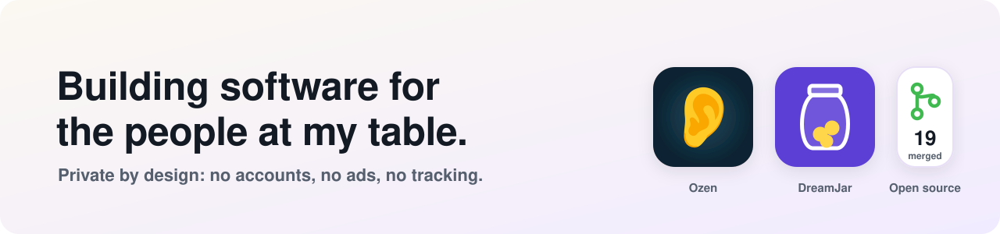

<picture>
  <source media="(prefers-color-scheme: dark)" srcset="assets/banner-dark.svg">
  
</picture>

## Projects

<table>
  <tr>
    <td width="50%" valign="top">
      
      <strong><a href="https://github.com/arbelonson-source/ozen">Ozen</a></strong> 
      Live captions for conversation, for people with hearing loss. Built for one grandmother, on her phone, private, and steady enough to read all evening.
        
      
      
      
    </td>
    <td width="50%" valign="top">
      
      <strong><a href="https://arbelonson-source.github.io/dreamjar-site/">DreamJar</a></strong> 
      A private, ad-free saving app for a child working toward one real thing they want to buy. No accounts, no servers, no ads, no analytics.
        
      
      
    </td>
  </tr>
</table>

## Open source contributions

19 merged pull requests in 10 projects. Most were written with Claude Code, and every one says it was made with AI.

| Project | What changed |
| --- | --- |
| [uutils/coreutils](https://github.com/uutils/coreutils) | 10 fixes that make the Rust coreutils behave like GNU's: [stat](https://github.com/uutils/coreutils/pull/14323), [numfmt](https://github.com/uutils/coreutils/pull/14322), [paste](https://github.com/uutils/coreutils/pull/14321), [csplit](https://github.com/uutils/coreutils/pull/14320), [join](https://github.com/uutils/coreutils/pull/14318), [truncate, paste, uniq](https://github.com/uutils/coreutils/pull/14258), [join, od](https://github.com/uutils/coreutils/pull/14257), [uniq, split](https://github.com/uutils/coreutils/pull/14255), [head, tail](https://github.com/uutils/coreutils/pull/14249), [fold](https://github.com/uutils/coreutils/pull/14248) |
| [Actual Budget](https://github.com/actualbudget/actual) | [Schedule templates no longer underfund long day and week intervals](https://github.com/actualbudget/actual/pull/8824) |
| [Cowrie](https://github.com/cowrie/cowrie) | [Socket log events go out on the reactor instead of blocking](https://github.com/cowrie/cowrie/pull/40619) |
| [Dolos](https://github.com/txpipe/dolos) | [Unmatched paths get Blockfrost's global 400](https://github.com/txpipe/dolos/pull/1349) |
| [MCP Hangar](https://github.com/mcp-hangar/mcp-hangar) | [The launch gets its own tracing span](https://github.com/mcp-hangar/mcp-hangar/pull/1571) |
| [ZeroClaw](https://github.com/zeroclaw-labs/zeroclaw) | [`ZEROCLAW_CONFIG_DIR` is honoured by the default config](https://github.com/zeroclaw-labs/zeroclaw/pull/10521) |
| [neva](https://github.com/RomanEmreis/neva) | [An error instead of a panic when a stdio server can't start](https://github.com/RomanEmreis/neva/pull/126) |
| [glab-tui](https://github.com/rcieri/glab-tui) | [Milestone progress no longer crashes on out-of-order brackets](https://github.com/rcieri/glab-tui/pull/408) |
| [lucid](https://github.com/Sn3akyy1/lucid) | [The installer warns on a Hyprland without Lua config](https://github.com/Sn3akyy1/lucid/pull/2) |
| [reliabot](https://github.com/dupuy/reliabot) | [pre-commit works in Git worktrees](https://github.com/dupuy/reliabot/pull/470) |
