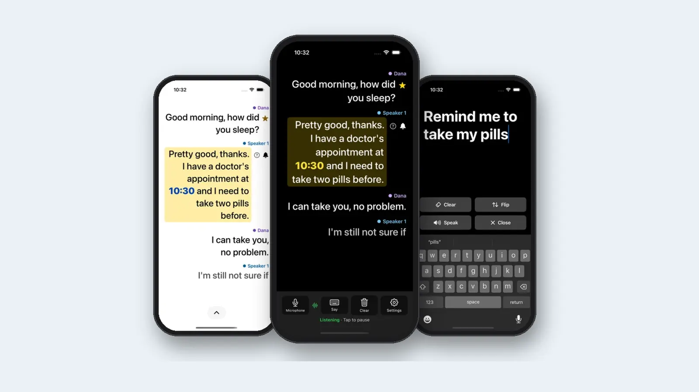
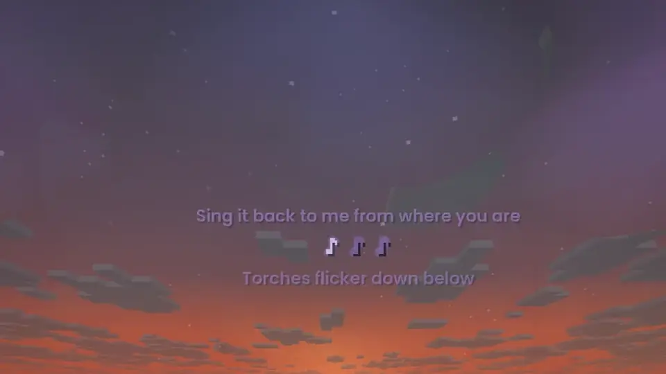
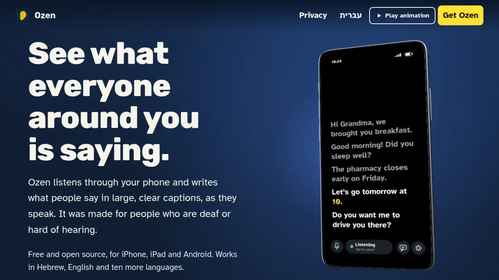
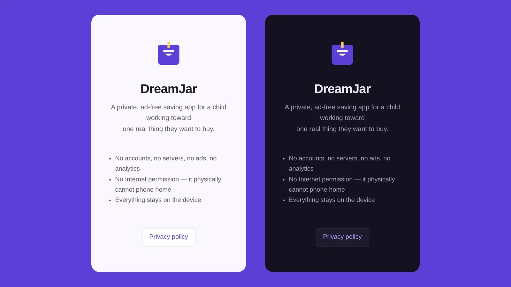

<picture>
  <source media="(max-width: 600px) and (prefers-color-scheme: dark)" srcset="assets/wordmark-phone-dark.svg">
  <source media="(max-width: 600px)" srcset="assets/wordmark-phone-light.svg">
  <source media="(prefers-color-scheme: dark)" srcset="assets/wordmark-dark.svg">
  
</picture>

My main project is Ozen, live captions built for one grandmother with hearing loss.

<a href="https://github.com/arbelonson-source/ozen">
<picture>
  <source media="(max-width: 600px) and (prefers-color-scheme: dark)" srcset="assets/ozen-phone-dark.webp">
  <source media="(max-width: 600px)" srcset="assets/ozen-phone-light.webp">
  <source media="(prefers-color-scheme: dark)" srcset="assets/ozen-dark.webp">
  
</picture>
</a>

**Ozen.** Live captions for conversation, for people who are deaf or hard of hearing. iPhone, iPad and Android. [App Store](https://apps.apple.com/app/id6821325968) / [Android](https://github.com/arbelonson-source/ozen/releases/latest) / [Source](https://github.com/arbelonson-source/ozen)

**Beli's SkyLyrics.** Synced lyrics for your current song, glowing in the Minecraft sky. A free Fabric mod for Linux, Windows and macOS. [Download](https://github.com/arbelonson-source/belis-skylyrics/releases) / [Source](https://github.com/arbelonson-source/belis-skylyrics)

<a href="https://ozen.live">
<picture>
  <source media="(max-width: 600px)" srcset="assets/ozen-live-phone.webp">
  
</picture>
</a>

**ozen.live.** Ozen's website, in English and Hebrew, with a 3D phone. [Visit ozen.live](https://ozen.live) / [עברית](https://ozen.live/he/) / [Source](https://github.com/arbelonson-source/ozen.live)

<a href="https://arbelonson-source.github.io/dreamjar-site/">
<picture>
  <source media="(max-width: 600px) and (prefers-color-scheme: dark)" srcset="assets/dreamjar-phone-dark.webp">
  <source media="(max-width: 600px)" srcset="assets/dreamjar-phone-light.webp">
  
</picture>
</a>

**DreamJar.** A private, ad-free Android app for saving up for one real purchase. It has no Internet permission. Everything stays on the device. [Website](https://arbelonson-source.github.io/dreamjar-site/)

Also: [Tidegrab](https://github.com/arbelonson-source/tidegrab), a turn-based diving game where 2 to 4 players bid in secret ([play it](https://tidegrab.arbelonski.workers.dev)).

## Open source

Fixes other people's projects have merged, newest first.

- Nov 15, **Obliteration**: [Windows CI downloads a Vulkan SDK that LunarG still serves.](https://github.com/obhq/obliteration/pull/1485)
- Nov 15, **Horizon**: [Happy ghasts now fly at their flying_speed attribute.](https://github.com/horizon-rust/horizon/pull/16570)
- Oct 31, **Horizon**: [Waypoints clear when the server reconfigures the client.](https://github.com/horizon-rust/horizon/pull/5143)
- Oct 19, **MCP Hangar**: [Shaping events are recorded only when a mutator applies.](https://github.com/mcp-hangar/mcp-hangar/pull/1574)
- Oct 8, **lucid**: [The installer lists files a replaced hyprland.conf sourced.](https://github.com/Sn3akyy1/lucid/pull/5)
- Oct 2, **Actual Budget**: [Schedule templates no longer underfund long day and week intervals.](https://github.com/actualbudget/actual/pull/8824)
- Oct 1, **Dolos**: [Unmatched paths return Blockfrost's global 400.](https://github.com/txpipe/dolos/pull/1349)
- Aug 30 to Oct 1, **uutils/coreutils**: ten fixes so the Rust coreutils behave like GNU's: [fold](https://github.com/uutils/coreutils/pull/14248), [uniq and split](https://github.com/uutils/coreutils/pull/14255), [stat](https://github.com/uutils/coreutils/pull/14323), [numfmt](https://github.com/uutils/coreutils/pull/14322), [join](https://github.com/uutils/coreutils/pull/14318), [paste](https://github.com/uutils/coreutils/pull/14321), [csplit](https://github.com/uutils/coreutils/pull/14320), [truncate, paste and uniq](https://github.com/uutils/coreutils/pull/14258), [join and od](https://github.com/uutils/coreutils/pull/14257), [head and tail](https://github.com/uutils/coreutils/pull/14249).

Earlier

- Sep 26, **mgmt**: [A test pins the parse error position for else if.](https://github.com/purpleidea/mgmt/commit/e8af1dfe96cb85e5c6cfc0a05b89a4f10c6461a6)
- Sep 26, **Cowrie**: [Socket log events go out on the reactor, not blocking.](https://github.com/cowrie/cowrie/pull/40619)
- Sep 24, **MCP Hangar**: [The launch step gets its own tracing span.](https://github.com/mcp-hangar/mcp-hangar/pull/1571)
- Sep 18, **arsenal-ng**: [The built command prints when the terminal won't take it.](https://github.com/halilkirazkaya/arsenal-ng/pull/24)
- Sep 15, **lucid**: [The installer warns when Hyprland has no Lua config.](https://github.com/Sn3akyy1/lucid/pull/2)
- Sep 11, **mgmt**: [Struct field names are now exported in Reflect.](https://github.com/purpleidea/mgmt/commit/1220d0d0ee31be3cecfff98834933fa1fb2989f4)
- Sep 5, **glab-tui**: [Milestone progress no longer crashes on out-of-order brackets.](https://github.com/rcieri/glab-tui/pull/408)
- Sep 4, **neva**: [Failed stdio server starts give an error, not a panic.](https://github.com/RomanEmreis/neva/pull/126)
- Sep 3, **ZeroClaw**: [The default config now honours ZEROCLAW_CONFIG_DIR.](https://github.com/zeroclaw-labs/zeroclaw/pull/10521)
- Aug 31, **reliabot**: [pre-commit now works in Git worktrees.](https://github.com/dupuy/reliabot/pull/470)

