<picture>
  <source media="(prefers-color-scheme: dark) and (max-width: 640px)" srcset="assets/hero-mobile-dark.svg">
  <source media="(prefers-color-scheme: light) and (max-width: 640px)" srcset="assets/hero-mobile-light.svg">
  <source media="(prefers-color-scheme: dark)" srcset="assets/hero-dark.svg">
  
</picture>

  <a href="#projects">Projects</a> &nbsp;&middot;&nbsp;
  <a href="#open-source-contributions">Open source</a> &nbsp;&middot;&nbsp;
  <a href="https://arbelonson-source.github.io/dreamjar-site/">DreamJar site</a>

  I'm Arbel. I make small, careful apps for particular people, starting with the ones at my own table. 
  Everything I publish is built to keep your data with you: no accounts, no ads, no tracking. 
  I also send small fixes to open source projects.

  <strong>Building with</strong> &nbsp;<code>Swift</code> <code>Kotlin</code> <code>Python</code> <code>TypeScript</code> <code>HTML</code> <code>Shell</code> 
  <strong>Contributing in</strong> &nbsp;<code>Rust</code> <code>Go</code> <code>Python</code> <code>TypeScript</code> <code>QML</code>

## Projects

<table>
  <tr>
    <td width="50%" valign="top">
       
      <strong><a href="https://github.com/arbelonson-source/ozen">Ozen</a></strong> 
      Live captions for conversation, for people with hearing loss. Built for one grandmother, on her phone, private, and steady enough to read all evening. An Android version has just started.
        
      <code>Swift 6</code> <code>iOS 17+</code> <code>AGPL-3.0</code>
    </td>
    <td width="50%" valign="top">
       
      <strong><a href="https://arbelonson-source.github.io/dreamjar-site/">DreamJar</a></strong> 
      A private, ad-free saving app for a child working toward one real thing they want to buy. No accounts, no servers, no ads, no analytics.
        
      <code>Android</code> <code>No internet</code>
    </td>
  </tr>
</table>

## Activity

<picture>
  <source media="(prefers-color-scheme: dark)" srcset="https://raw.githubusercontent.com/arbelonson-source/arbelonson-source/output/snake-dark.svg">
  
</picture>

<picture>
  <source media="(prefers-color-scheme: dark)" srcset="https://raw.githubusercontent.com/arbelonson-source/arbelonson-source/output/languages-dark.svg">
  
</picture>

## Open source contributions

Small, careful fixes sent to other people's projects.

| Project | What changed |
| --- | --- |
| [uutils/coreutils](https://github.com/uutils/coreutils) | 10 fixes that make the Rust coreutils behave like GNU's: [stat](https://github.com/uutils/coreutils/pull/14323), [numfmt](https://github.com/uutils/coreutils/pull/14322), [paste](https://github.com/uutils/coreutils/pull/14321), [csplit](https://github.com/uutils/coreutils/pull/14320), [join](https://github.com/uutils/coreutils/pull/14318), [truncate, paste, uniq](https://github.com/uutils/coreutils/pull/14258), [join, od](https://github.com/uutils/coreutils/pull/14257), [uniq, split](https://github.com/uutils/coreutils/pull/14255), [head, tail](https://github.com/uutils/coreutils/pull/14249), [fold](https://github.com/uutils/coreutils/pull/14248) |
| [Actual Budget](https://github.com/actualbudget/actual) | [Schedule templates no longer underfund long day and week intervals](https://github.com/actualbudget/actual/pull/8824) |
| [Cowrie](https://github.com/cowrie/cowrie) | [Socket log events go out on the reactor instead of blocking](https://github.com/cowrie/cowrie/pull/40619) |
| [mgmt](https://github.com/purpleidea/mgmt) | [Struct field names are exported in Reflect](https://github.com/purpleidea/mgmt/commit/1220d0d0ee31be3cecfff98834933fa1fb2989f4), [a test pins the parse error position of `else if`](https://github.com/purpleidea/mgmt/commit/e8af1dfe96cb85e5c6cfc0a05b89a4f10c6461a6) |
| [Dolos](https://github.com/txpipe/dolos) | [Unmatched paths get Blockfrost's global 400](https://github.com/txpipe/dolos/pull/1349) |
| [MCP Hangar](https://github.com/mcp-hangar/mcp-hangar) | [The launch gets its own tracing span](https://github.com/mcp-hangar/mcp-hangar/pull/1571) |
| [ZeroClaw](https://github.com/zeroclaw-labs/zeroclaw) | [`ZEROCLAW_CONFIG_DIR` is honoured by the default config](https://github.com/zeroclaw-labs/zeroclaw/pull/10521) |
| [neva](https://github.com/RomanEmreis/neva) | [An error instead of a panic when a stdio server can't start](https://github.com/RomanEmreis/neva/pull/126) |
| [arsenal-ng](https://github.com/halilkirazkaya/arsenal-ng) | [The built command is printed when the terminal won't take it](https://github.com/halilkirazkaya/arsenal-ng/pull/24) |
| [glab-tui](https://github.com/rcieri/glab-tui) | [Milestone progress no longer crashes on out-of-order brackets](https://github.com/rcieri/glab-tui/pull/408) |
| [lucid](https://github.com/Sn3akyy1/lucid) | [The installer warns on a Hyprland without Lua config](https://github.com/Sn3akyy1/lucid/pull/2), [and names the files a replaced `hyprland.conf` sourced](https://github.com/Sn3akyy1/lucid/pull/5) |
| [reliabot](https://github.com/dupuy/reliabot) | [pre-commit works in Git worktrees](https://github.com/dupuy/reliabot/pull/470) |

<picture>
  <source media="(prefers-color-scheme: dark)" srcset="assets/divider-dark.svg">
  
</picture>

Private by design. The images above are made by a small automatic job once a day. No counters, no trackers.

